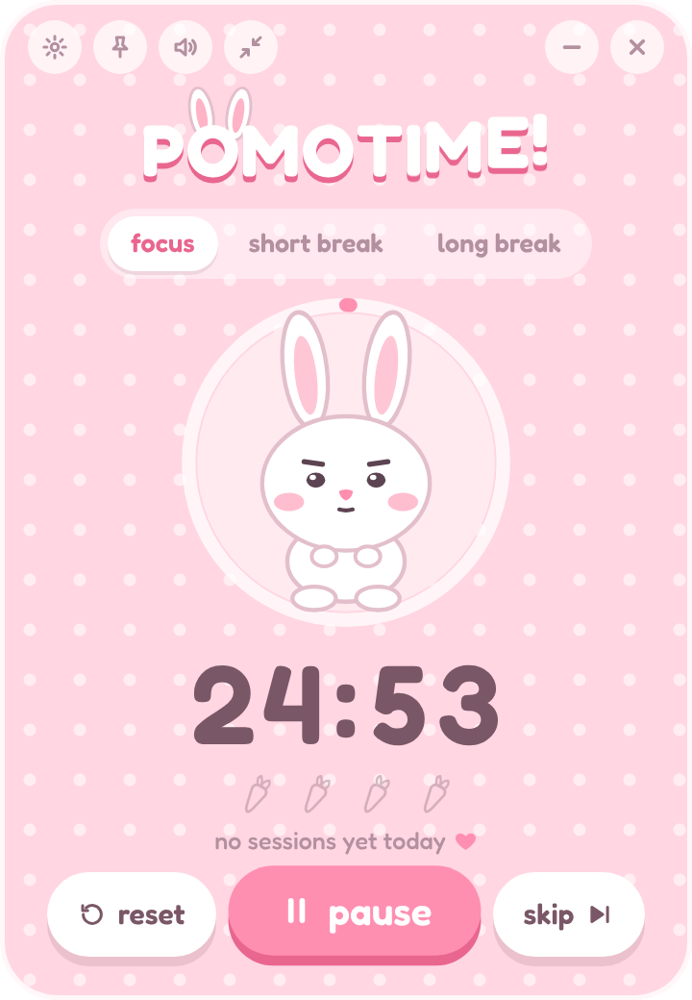
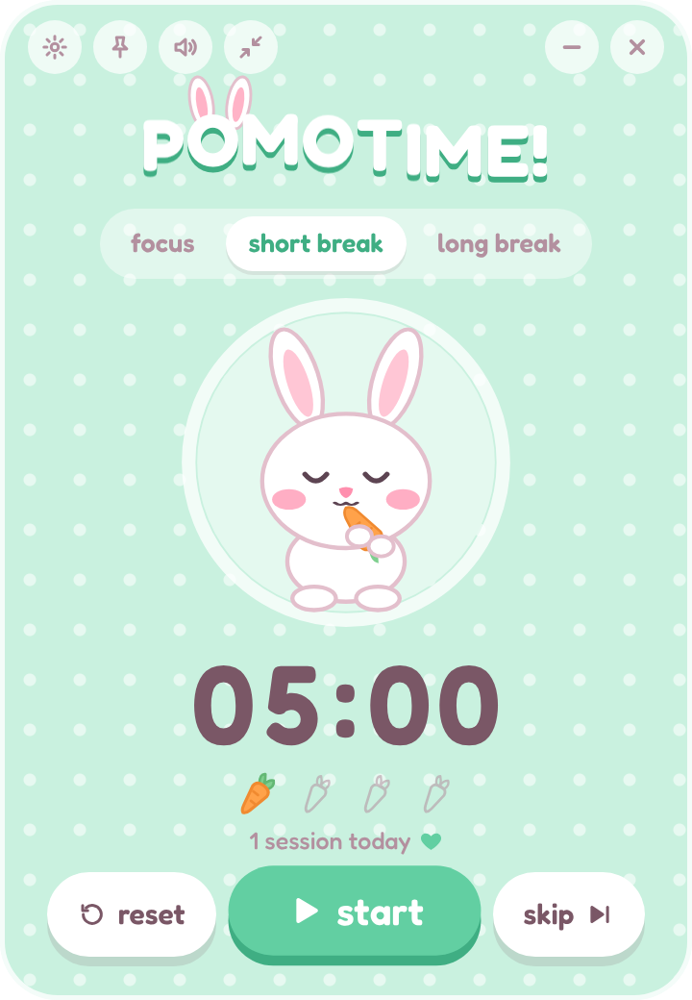
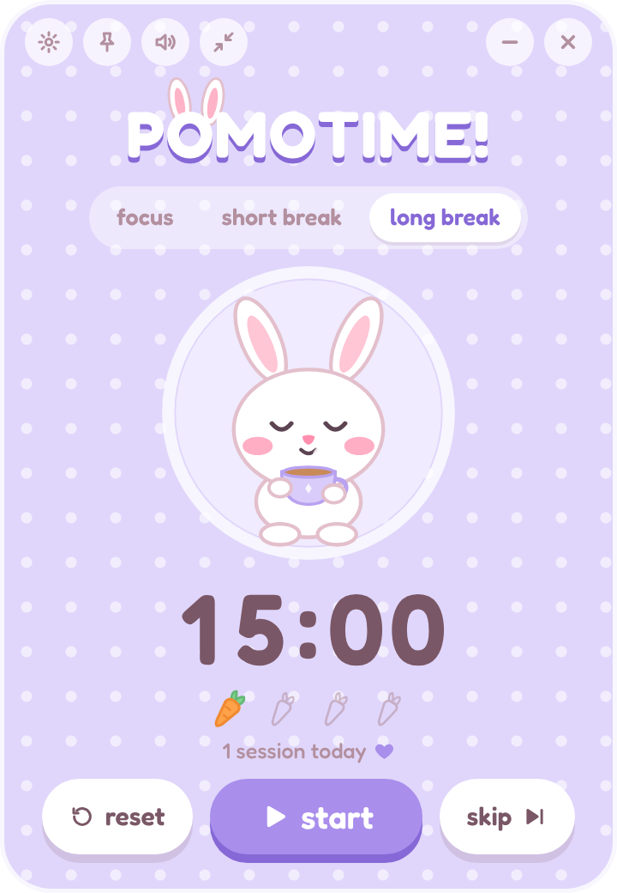
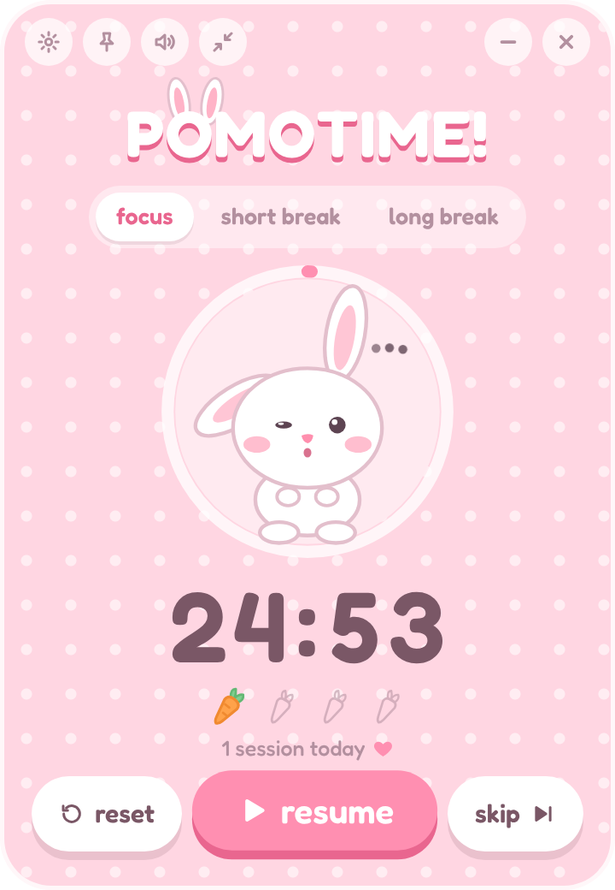
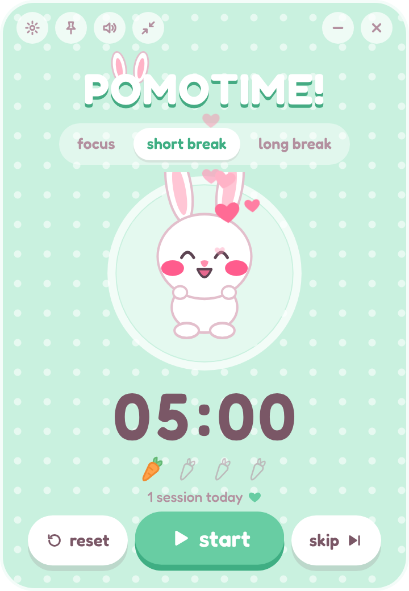
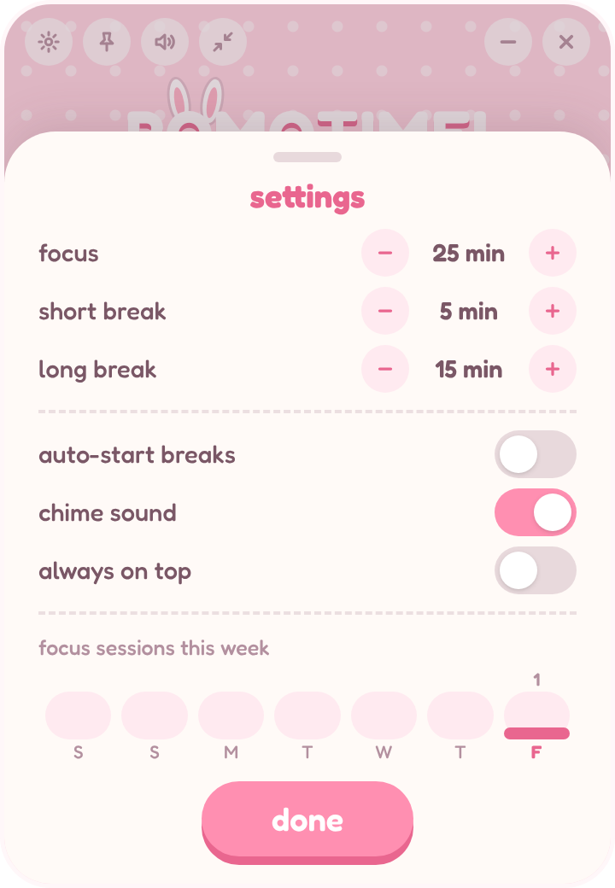
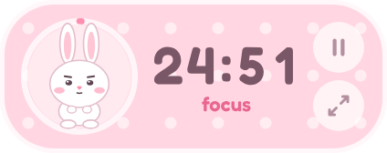

# POMOTIME! 🐰

A tiny, cozy Pomodoro timer with a bunny who keeps you company on your desktop.
Pastel pink while you focus, mint for short breaks, lavender for long ones.

<p align="center">
  
  
  
</p>
<p align="center">
  
  
  
</p>
<p align="center">
  
</p>

## What it does

- **Three modes**: Focus (25 min), Short Break (5 min) and Long Break (15 min, after every 4 focus sessions). Switch by hand with the tabs at the top.
- **A bunny with moods**: concentrating while you focus, munching a carrot or sipping tea on breaks, one floppy ear when paused, and a hop with hearts when a session is done. It blinks, twitches its nose and wiggles its ears on its own.
- **Carrot row**: one carrot per finished focus session; four carrots earn the long break.
- **Tray / menu bar bunny** showing the time left (next to the icon on macOS, in the tooltip on Windows), with Start/Pause, Reset, Skip and Quit.
- **Notification and a gentle chime** when a timer ends. The speaker button mutes the chime.
- **Always on top** (the pin button) and **mini mode** (the shrink button): a tiny floating bunny plus the countdown.
- **Global shortcut**: `Ctrl+Shift+P` (`Cmd+Shift+P` on Mac) starts and pauses from any app. Inside the window, `Space` does the same.
- **Settings** (the gear button): durations, auto-start breaks, sound, always on top, and a little chart of this week's sessions.
- Settings and session history are saved between launches.

## Setup

You need [Node.js](https://nodejs.org) 20 or newer.

```bash
npm install
```

Run the app with live reload while developing:

```bash
npm run dev
```

Run the built app, the way it will behave once installed:

```bash
npm start
```

Build an installer for the computer you are on:

```bash
npm run build
```

The installer lands in `dist/`: a `.dmg` on macOS, a setup `.exe` on Windows.
Each one has to be built on its own operating system. To be explicit about the target:

```bash
npm run build:mac
```

```bash
npm run build:win
```

The installers are not code-signed, so the first launch shows a warning.
On macOS, right-click the app and choose **Open**. On Windows, choose **More info → Run anyway**.

### Other commands

| Command             | What it does                                                    |
| ------------------- | --------------------------------------------------------------- |
| `npm run typecheck` | Type-check the main, preload and renderer code                  |
| `npm run lint`      | ESLint                                                          |
| `npm run format`    | Prettier                                                        |
| `npm run icons`     | Redraw the app and tray icons from `scripts/generate-icons.mjs` |

To watch a full cycle quickly, set `POMOTIME_FAST=1` before `npm run dev`. Minutes become seconds.

## Tech stack

| Piece                  | Used for                                                                  |
| ---------------------- | ------------------------------------------------------------------------- |
| **Electron**           | Desktop shell: frameless window, tray, notifications, global shortcut     |
| **electron-vite**      | Build tooling and hot reload for main, preload and renderer               |
| **React + TypeScript** | The UI                                                                    |
| **Tailwind CSS v4**    | Styling                                                                   |
| **Framer Motion**      | Every animation: bunny springs, button squish, mode transitions, hearts   |
| **Zustand**            | Timer and settings state (a vanilla store in main, hook stores in the UI) |
| **electron-store**     | Saving settings and session history to a local JSON file                  |
| **electron-builder**   | Packaging the `.dmg` and `.exe`                                           |
| **Fredoka**            | The bubbly font, bundled with the app so it works offline                 |

## How it is put together

```
src/
├── shared/              Types used by both sides
│   ├── types.ts         Timer, settings and history shapes
│   └── ipc.ts           Every IPC channel and its payload, in one place
├── main/                Electron main process
│   ├── index.ts         App start-up, notifications, global shortcut
│   ├── timer.ts         The timer itself (Zustand vanilla store)
│   ├── persistence.ts   electron-store: settings, history, carrot row
│   ├── tray.ts          Tray icon, countdown and menu
│   ├── window.ts        Frameless window, mini mode, always on top
│   └── ipc.ts           Typed ipcMain helpers
├── preload/
│   └── index.ts         The small typed API exposed as window.pomo
└── renderer/src/
    ├── components/      TitleBar, Header, ModeTabs, TimerRing, Countdown, ...
    │   └── Bunny/       Ears, Eyes, Blush, Nose, Mouth, Treats, Hearts
    ├── hooks/           useCountdown, useBunnyMood, useRandomPulse, ...
    ├── store/           useTimerStore, useSettingsStore
    └── lib/             Colours per mode, shared springs, the chime
```

**The timer runs in the main process.** That keeps the tray, the shortcut and the
notification working when the window is minimised or in mini mode. It stores the
timestamp a session ends at and works out the time left from the clock, so it
cannot drift, and it catches up correctly after the computer sleeps. The
renderer mirrors that state in its Zustand stores and only draws it.

**The renderer is locked down.** `contextIsolation` is on, `nodeIntegration` is
off, and the window is sandboxed. The UI can only reach the main process through
the functions in `src/preload/index.ts`. Channel names and payloads are declared
once in `src/shared/ipc.ts`, so a typo or a wrong argument is a compile error on
either side.

**The bunny** is one SVG made of separate React components. Each part has its
own Framer Motion spring, so the ears, eyes, cheeks and nose move independently.

## Where your data lives

Everything is in one file, `pomotime.json`:

- macOS: `~/Library/Application Support/POMOTIME!/pomotime.json`
- Windows: `%APPDATA%\POMOTIME!\pomotime.json`

Delete it to start fresh.

## Credits

[Fredoka](https://fonts.google.com/specimen/Fredoka) is licensed under the SIL Open Font License.
